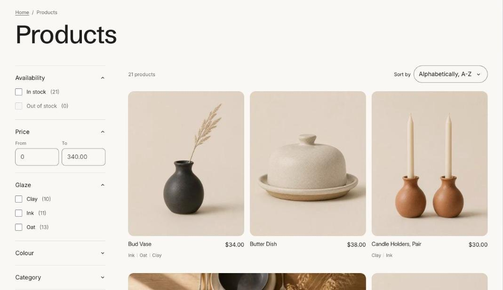

import { Aside, Steps } from '@astrojs/starlight/components';

The collection page shows the collection's title, description and image, then the product grid with filters and sorting. Edit it by choosing **Collections > Default collection** in the template picker.

## Promo tiles

Add **Promo tile** blocks to place an image or message card inside the grid, such as a sale banner or a link to a guide. Choose the position in the grid for each tile.

## Filters

Filters come from the Search and Discovery app. See [Collection filters](/tandem/collections/filters/).

## Section settings

| Setting | Type | What it does |
| --- | --- | --- |
| Color scheme | Color scheme | One of the schemes from Theme settings > Colors. |
| **Collection header** | | |
| Show collection description | On or off |  |
| Show collection image | On or off |  |
| **Product grid** | | |
| Products per page | Slider | 8 to 48. |
| Pagination | Choice | Load more button / Infinite scroll / Numbered pages. |
| Products per row on desktop | Slider | 2 to 5. |
| Show second image on hover | On or off | Shows the product's second image when a shopper hovers over the card. |
| Show vendor | On or off | Shows the brand above the product title. |
| **Filtering and sorting** | | |
| Enable filtering | On or off | Set up filters in the Search and Discovery app. |
| Enable sorting | On or off |  |

## Blocks

You can add up to 4 blocks.

### Promo tile

| Setting | Type | What it does |
| --- | --- | --- |
| Show after product | Slider | 1 to 24. |
| Width | Choice | One product / Two products. |
| Image | Image | Upload an image or pick one from your files. |
| Small heading | Text | A short line above the heading, such as a category or a promise. |
| Heading | Text | Leave empty to hide it. |
| Text | Text | Supporting copy under the heading. |
| Button label | Text | Leave empty to hide the button. |
| Button link | Link | A page, product, collection or web address. |
| Color scheme | Color scheme | One of the schemes from Theme settings > Colors. |
