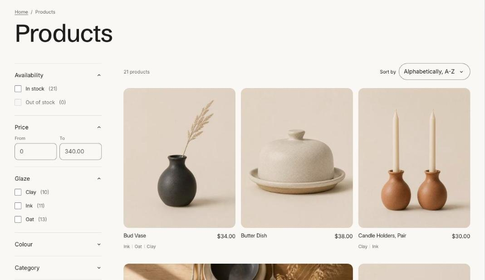

import { Steps, Aside } from '@astrojs/starlight/components';

Filters come from Shopify's free **Search and Discovery** app. Tandem shows them in a sidebar on larger screens and a drawer on phones.

<Steps>

1. Install **Search and Discovery** from the Shopify App Store if it isn't already installed.
2. In the app, open **Filters** and click **Add filter**.
3. Choose a source: availability, price, product type, vendor, tags, a variant option such as size or color, or a product metafield such as material.
4. Save, then make sure **Enable filtering** is on in the **Product grid** section of the collection template and in **Search results**.

</Steps>

<Aside>
A filter only shows values that products in that collection have. A filter with no values on a collection is hidden.
</Aside>

## Filter by metafield

To filter by something like material or roast, create a product metafield first (see [Metafields](/tandem/guides/metafields/)), fill it in on your products, then add it as a filter in Search and Discovery.
