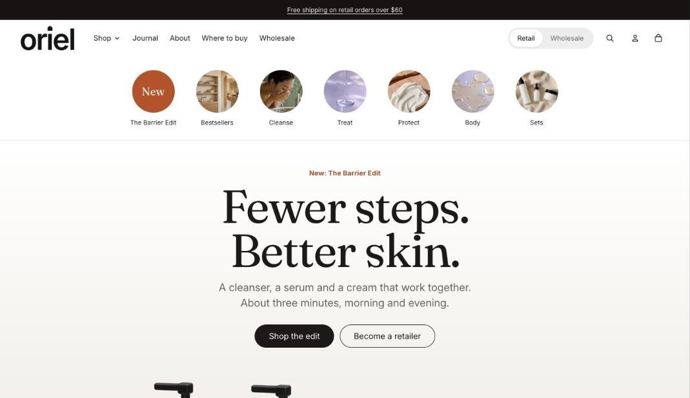
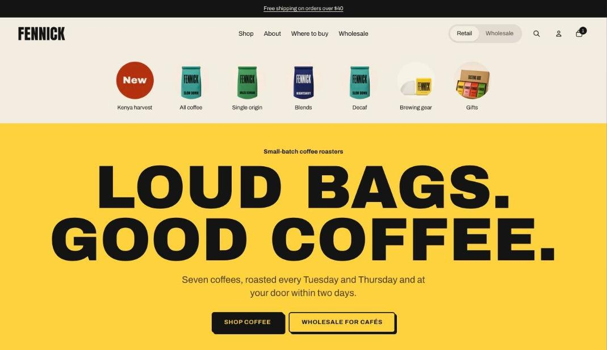
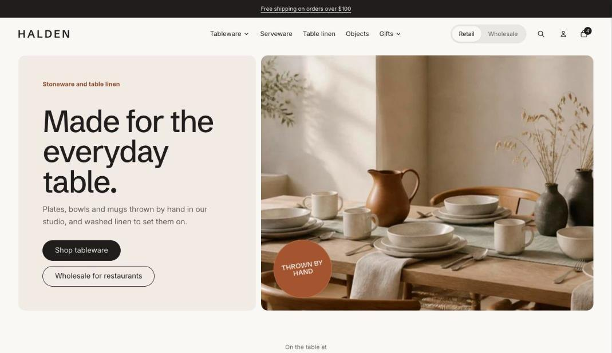

A preset is a starting point: a set of colors, fonts, shapes and home page sections. Every preset uses the same sections and settings, so you can take any idea from one and use it in another.

| Preset | Made for | Look |
| --- | --- | --- |
| **Tandem** | Beauty, skincare and wellness | Fraunces serif headings with Inter body text, soft rounded shapes and a calm palette |
| **Larder** | Coffee, food and pantry goods | Archivo Black uppercase headings, bordered cards with a hard shadow and square buttons |
| **Halden** | Homeware, ceramics and furniture | Schibsted Grotesk headings with Inter body text and a quiet neutral palette |

## Tandem

The home page leads with a hero and a trust strip, then a featured collection, a scroll story with product shots, a product bundle, before and after images and a video carousel.

## Larder

The home page leads with a bold hero, then a featured collection, a sale countdown, collection tiles, a shoppable image and testimonials in moving rows.

## Halden

The home page leads with a split hero, then a featured collection, a scroll story with a Lottie animation, a shoppable image and a featured product.

## Switch presets

To try another preset, go to **Online Store > Themes**, add Tandem again from the Theme Store and choose the other preset. Your current copy keeps its settings, so you can compare them side by side and copy over what you want to keep.
