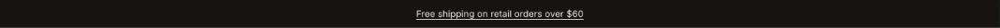

import { Aside, Steps } from '@astrojs/starlight/components';

The announcement bar is a single line above the header for shipping offers, launches or opening hours. It can only be added to the header group.

## Add the section

<Steps>

1. Open **Online Store > Themes > Customize** and go to the header group.
2. Click **Add section** and choose **Announcement bar**.
3. Fill in the content, then click **Save**.

</Steps>

## Section settings

| Setting | Type | What it does |
| --- | --- | --- |
| Text | Text | Supporting copy under the heading. |
| Link | Link | A page, product, collection or web address. |
| Color scheme | Color scheme | One of the schemes from Theme settings > Colors. |
