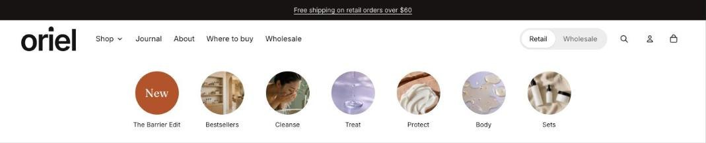

import { Aside, Steps } from '@astrojs/starlight/components';

The collection scroller is a row of small round or arched collection images with a label under each. Put it in the header group to show it on every page, or at the top of one template. A text tile can stand in for an image, such as a Sale circle. On collection pages the current collection is marked, so it doubles as navigation.

## Add the section

<Steps>

1. Open **Online Store > Themes > Customize** and go to the header group or the top of a template.
2. Click **Add section** and choose **Collection scroller**.
3. Fill in the content, then click **Save**.

</Steps>

## Section settings

| Setting | Type | What it does |
| --- | --- | --- |
| Heading | Text | Leave empty to hide it. |
| Show on | Choice | All pages / Home and collection pages / Home page only. Applies when the section is in the header. It always shows in the theme editor. |
| **Layout** | | |
| Image shape | Choice | Circle / Arch / Rounded square. |
| Image size | Choice | Small / Medium / Large. |
| Image fit | Choice | Fill / Fit. Fill crops the image to the frame. Fit shows the whole image, which suits product cut-outs and wide line-ups. |
| Alignment | Choice | Left / Center. Applies when every collection fits on screen. Longer rows scroll from the start. |
| Show arrows | On or off | Arrows appear on larger screens when the row scrolls. Phones swipe. |
| Scroll automatically | On or off | Moves in a slow, continuous loop when the row is wider than the screen. It stops while a shopper hovers, touches or swipes it, and starts again when they let go. Shoppers who prefer reduced motion see a still row. |
| Speed | Choice | Slow / Medium / Fast. |
| Show divider below | On or off |  |
| Color scheme | Color scheme | One of the schemes from Theme settings > Colors. |

## Blocks

You can add up to 24 blocks.

### Collection

| Setting | Type | What it does |
| --- | --- | --- |
| Collection | Collection |  |
| Image | Image | Uses the collection image if empty. |
| Label | Text | Uses the collection title if empty. |
| Link | Link | Uses the collection link if empty. Link to a filtered collection or any page. |

### Text tile

| Setting | Type | What it does |
| --- | --- | --- |
| Text in the circle | Text | Keep it to a word or two, such as Sale or New. |
| Label | Text |  |
| Link | Link | A page, product, collection or web address. |
| Style | Choice | Accent / Dark / Outline. |
