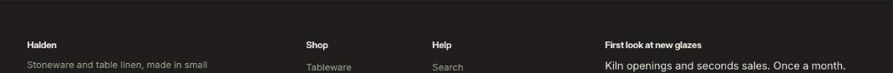

import { Aside, Steps } from '@astrojs/starlight/components';

The footer sits in the footer group and shows on every page. Build it from **Menu**, **Text** and **Email signup** blocks, then turn on the extras you need below them.

## Section settings

| Setting | Type | What it does |
| --- | --- | --- |
| Color scheme | Color scheme | One of the schemes from Theme settings > Colors. |
| Show social media links | On or off | Add links in theme settings under Social media. |
| **Country and language** | | |
| Show country selector | On or off | Appears when you sell in more than one country. |
| Show language selector | On or off | Appears when your store has more than one language. |
| **Bottom bar** | | |
| Show Follow on Shop | On or off | Lets shoppers follow your store in the Shop app. Shop Pay must be turned on. |
| Show payment icons | On or off |  |
| Show Powered by Shopify | On or off |  |

## Blocks

You can add up to 6 blocks.

### Menu

| Setting | Type | What it does |
| --- | --- | --- |
| Heading | Text | Leave empty to hide it. |
| Menu | Menu |  |

### Text

| Setting | Type | What it does |
| --- | --- | --- |
| Heading | Text | Leave empty to hide it. |
| Text | Rich text | Supporting copy under the heading. |

### Email signup

| Setting | Type | What it does |
| --- | --- | --- |
| Heading | Text | Leave empty to hide it. |
| Text | Rich text | Supporting copy under the heading. |

## Tips

- Social icons come from the links in Theme settings > Social media.
- The country and language selectors only show when you sell in more than one market or language.
