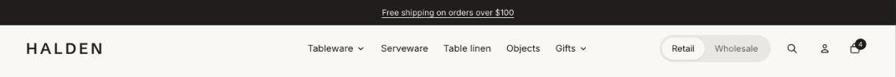

import { Aside, Steps } from '@astrojs/starlight/components';

The header holds your logo, main menu, search, account and cart. It sits in the header group, so it shows on every page and you edit it once.

On phones the menu and search sit to the left of the logo and the account and cart to the right, so the logo stays centered.

## Menus and mega menus

Build the menu in **Content > Menus** (or **Online Store > Navigation**), then pick it in **Main menu**. Nested links become dropdowns. Turn on **Mega menu on desktop** to show second-level links as columns, and add **Menu promo** blocks to place an image card inside a mega menu next to a chosen top-level link.

## Sticky header

Choose whether the header stays at the top while shoppers scroll, or only comes back when they scroll up. **Keep announcement bar visible** keeps the bar above it pinned too.

## Retail / Wholesale switch

Turn on **Show Retail / Wholesale switch** to add a toggle for wholesale buyers. Set **Wholesale page** to where shoppers without a wholesale account go (such as your trade page), and **Wholesale customer page** to where signed-in buyers go (such as quick order). See [Header switch](/tandem/wholesale/header-switch/).

## Section settings

| Setting | Type | What it does |
| --- | --- | --- |
| Color scheme | Color scheme | One of the schemes from Theme settings > Colors. |
| Sticky header | Choice | None / Always / On scroll up. |
| Keep announcement bar visible | On or off | The announcement bar sticks with the header. |
| **Logo** | | |
| Logo image | Image |  |
| Logo width | Slider | 60 to 300px. |
| Logo width on phones | Slider | 50 to 200px. |
| **Navigation** | | |
| Main menu | Menu |  |
| Menu position on desktop | Choice | Beside the logo / Center. |
| Mega menu on desktop | On or off | Menu items with their own links open a full-width panel. Links that have their own links become columns. |
| **Retail and wholesale** | | |
| Show Retail / Wholesale switch | On or off |  |
| Wholesale page | Link | Where Wholesale takes shoppers who aren't signed in to a wholesale account, such as a page about your wholesale program. Leave blank to use the sign-in page. |
| Wholesale customer page | Link | Where Wholesale takes signed-in wholesale customers, such as your quick order page. Leave blank to use all collections. |
| Customer account menu | Menu |  |

## Blocks

### Menu promo

| Setting | Type | What it does |
| --- | --- | --- |
| Menu item | Text | The title of the top-level menu item to show it in, such as Shop. |
| Image | Image | Upload an image or pick one from your files. |
| Heading | Text | Leave empty to hide it. |
| Text | Text | Supporting copy under the heading. |
| Button link | Link | A page, product, collection or web address. |

## Tips

- Upload a logo with no extra space around it so the width settings size it accurately.
- Set a separate logo width for phones if your logo is wide.
