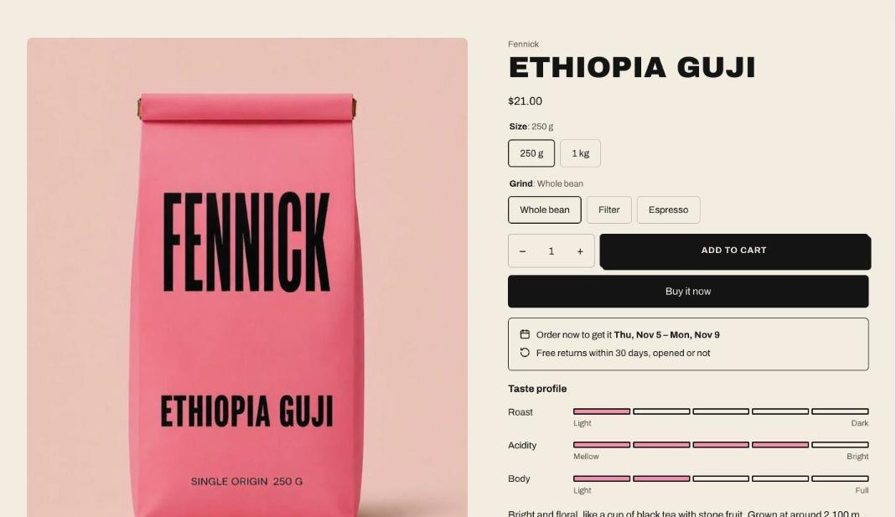

import { Steps } from '@astrojs/starlight/components';

The accent color tints the image gallery background and fills the taste scale, so a product page picks up the color of the product: green for a matcha, amber for a honey.

<Steps>

1. Go to **Settings > Custom data > Products** and add a **Color** definition, such as **Accent** with the key `custom.accent`.
2. On each product, pick a color. A soft, light shade works best behind product photos.
3. In the theme editor, select **Product information** and enter `custom.accent` in **Accent color metafield**.

</Steps>

Products without a color use the section's color scheme.
