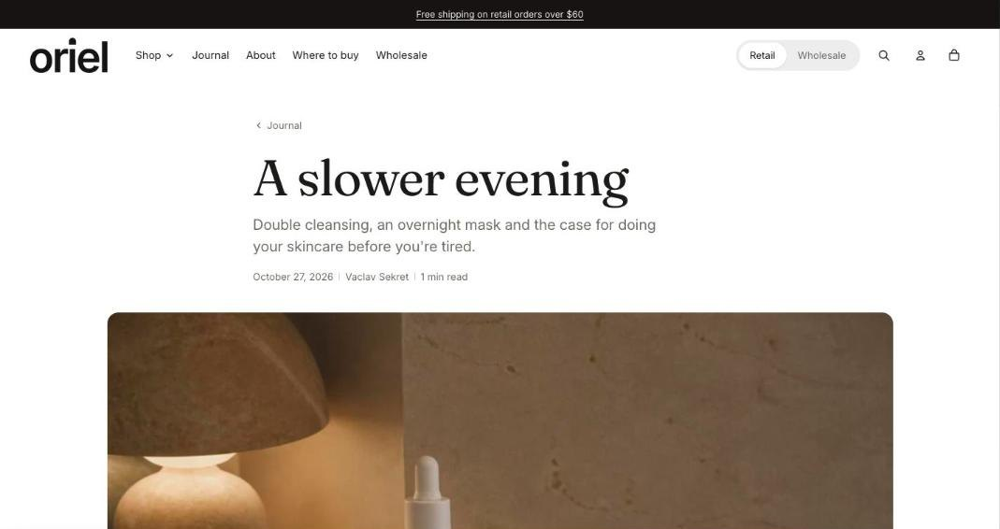

import { Aside, Steps } from '@astrojs/starlight/components';

The article page shows the title, excerpt, date, author, reading time and featured image, then the content. It can add a table of contents from the article's H2 headings, products from the article ("Shop the story"), tags, share links and the author's bio.

## Show products in an article

Create an article metafield of type **Product list**, such as `custom.products`, in **Settings > Custom data > Blog posts**. Pick products on each article, then enter the key in **Products metafield**. Up to three products show.

## Section settings

| Setting | Type | What it does |
| --- | --- | --- |
| Show featured image | On or off |  |
| Show summary under the title | On or off | Uses the article's excerpt. |
| Show date | On or off |  |
| Show author | On or off |  |
| Show reading time | On or off |  |
| Show table of contents | On or off | Built from the article's H2 headings. Only shown on articles with enough headings. |
| Headings needed for a table of contents | Slider | 2 to 8. |
| **Shop the story** | | |
| Show products | On or off |  |
| Heading | Text | Leave empty to hide it. |
| Products metafield | Text | Namespace and key of a product list metafield on articles, such as custom.products. Up to 3 products show. |
| **Author** | | |
| Show author bio | On or off | Uses the bio and photo from the author's staff account, when there is one. |
| Show tags | On or off |  |
| Show share links | On or off |  |
| Color scheme | Color scheme | One of the schemes from Theme settings > Colors. |
