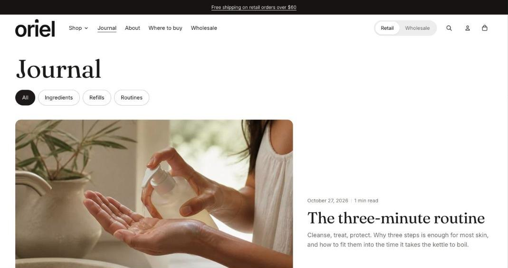

import { Aside, Steps } from '@astrojs/starlight/components';

The blog page shows the blog title, a tag filter and a grid of article cards. The newest article can lead the first page as a large story.

## Section settings

| Setting | Type | What it does |
| --- | --- | --- |
| Articles per row on desktop | Slider | 2 to 4. |
| Articles per page | Slider | 3 to 24. |
| Lead with the newest article | On or off | Shows the newest article as a large story at the top of the first page, when there are at least three. |
| Show tags | On or off |  |
| Show featured image | On or off |  |
| Show date | On or off |  |
| Show author | On or off |  |
| Show excerpt | On or off |  |
| Show reading time | On or off |  |
| Color scheme | Color scheme | One of the schemes from Theme settings > Colors. |
