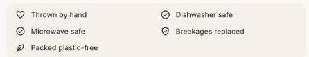

import { Steps } from '@astrojs/starlight/components';

The **Highlights** block shows up to four short lines with icons, such as "Free shipping over $50" or "Vegan and cruelty-free". It can also add lines from a product metafield, so care notes or materials can differ from product to product.

## Add highlights from a metafield

<Steps>

1. Go to **Settings > Custom data > Products** and add a definition, such as **Care** with the key `custom.care`. Choose **Single line text** and select **List of values**.
2. On each product, add the lines you want, such as "Dishwasher safe".
3. In the theme editor, select the **Highlights** block and enter `custom.care` in **Metafield**.
4. Choose the icon for these lines and where they go: before the typed highlights, after the first one or at the end.

</Steps>

Products with no value show only the typed highlights.
