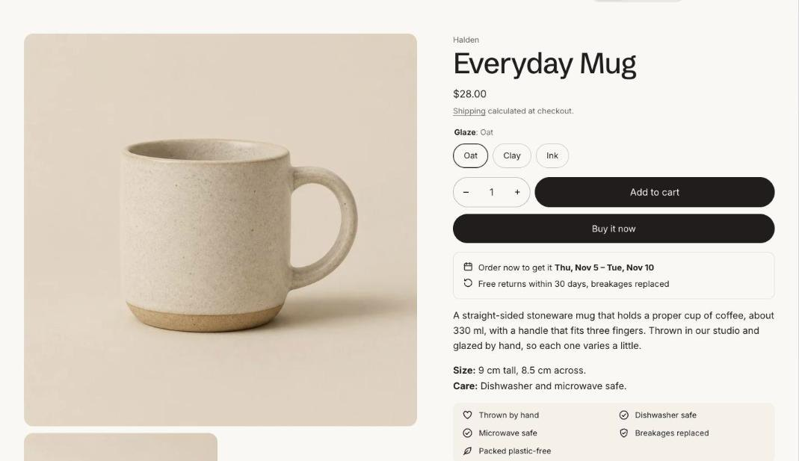

import { Steps } from '@astrojs/starlight/components';

The product page is built from the **Product information** section: the image gallery on one side and a column of blocks on the other. Below it you can add any section, such as product recommendations, recently viewed, a comparison table or an FAQ.

## Edit the product page

<Steps>

1. Open the theme editor and choose **Products > Default product** in the template picker.
2. Select **Product information** to change the gallery and page settings.
3. Add, remove and reorder blocks in the column on the right. See [Product blocks](/tandem/product-page/blocks/).

</Steps>

## Section settings

| Setting | Type | What it does |
| --- | --- | --- |
| Color scheme | Color scheme | One of the schemes from Theme settings > Colors. |
| Sticky add to cart | On or off | On phones, a bar at the bottom of the screen once the add to cart button scrolls out of view. |
| Also show on larger screens | On or off | A slim bar under the header once shoppers scroll past the product details. |
| **Gallery** | | |
| Desktop gallery | Choice | Grid / One image with thumbnails. |
| Mobile gallery | Choice | Swipe with an image count / One image with thumbnails. |
| Image zoom | On or off | Pressing a product image opens it full screen, where it can be zoomed. |
| Accent color metafield | Text | Key of a product color metafield, such as custom.accent. Tints the image gallery and fills the taste scale, so each product can carry its own color. |

## Gallery

On larger screens choose **Grid**, which shows every image, or **One image with thumbnails**. On phones choose a swipeable gallery with an image count, or one image with thumbnails. Images, videos and 3D models all show in the gallery, and **Image zoom** opens a full-screen viewer.

When a shopper picks a variant that has its own image, the gallery jumps to it.

## Sticky add to cart

**Sticky add to cart** shows a slim bar with the price and add button once the main button scrolls out of view. It shows on phones, and on larger screens too if you turn on **Also show on larger screens**.
