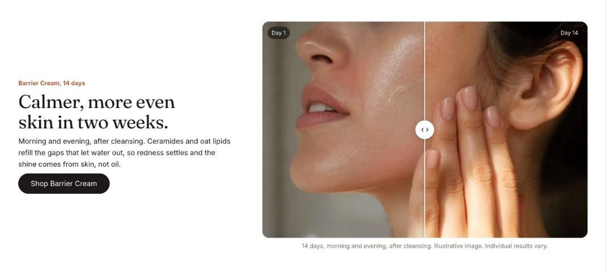

import { Aside, Steps } from '@astrojs/starlight/components';

Before and after stacks two images with a handle to wipe between them. Shoppers can drag, tap or use the arrow keys, and screen readers announce the position. Each **Comparison** block is one pair of images.

## Add the section

<Steps>

1. Open **Online Store > Themes > Customize** and go to any page.
2. Click **Add section** and choose **Before and after**.
3. Fill in the content, then click **Save**.

</Steps>

## Section settings

| Setting | Type | What it does |
| --- | --- | --- |
| Small heading | Text | A short line above the heading, such as a category or a promise. |
| Heading | Text | Leave empty to hide it. |
| Text | Rich text | Supporting copy under the heading. |
| Button label | Text | Leave empty to hide the button. |
| Button link | Link | A page, product, collection or web address. |
| Study details | Text | Who took part, for how long and how it was measured, such as "32 people, 14 days, measured by a dermatologist". Shown under the first image, before its caption. |
| Layout | Choice | Text above / Text beside. |
| Color scheme | Color scheme | One of the schemes from Theme settings > Colors. |

## Blocks

You can add up to 4 blocks.

### Comparison

| Setting | Type | What it does |
| --- | --- | --- |
| Before image | Image |  |
| Before label | Text |  |
| After image | Image | Use two images of the same size and framing. |
| After label | Text |  |
| Starting position | Slider | 10 to 90%. |
| Caption | Text |  |
