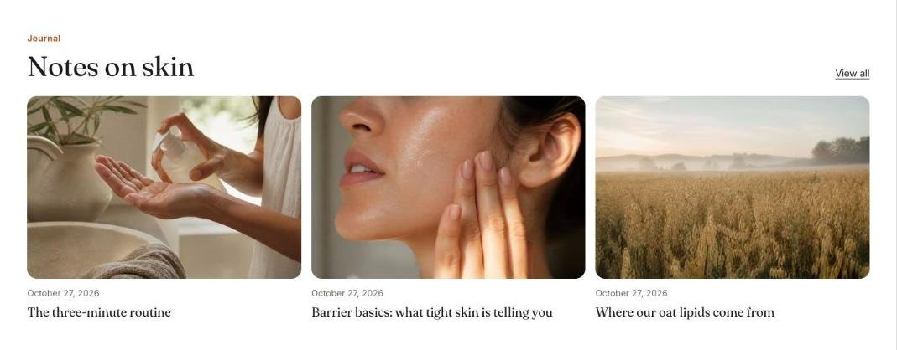

import { Aside, Steps } from '@astrojs/starlight/components';

Blog posts shows the latest posts from one blog as a grid on larger screens and a swipeable row on phones.

## Add the section

<Steps>

1. Open **Online Store > Themes > Customize** and go to the home page (or any template).
2. Click **Add section** and choose **Blog posts**.
3. Fill in the content, then click **Save**.

</Steps>

## Section settings

| Setting | Type | What it does |
| --- | --- | --- |
| Small heading | Text | A short line above the heading, such as a category or a promise. |
| Heading | Text | Leave empty to hide it. |
| Blog | Blog |  |
| Posts to show | Slider | 2 to 4. |
| Show date | On or off |  |
| Show excerpt | On or off |  |
| Show "View all" link | On or off | Links to the full collection or blog. |
| Color scheme | Color scheme | One of the schemes from Theme settings > Colors. |
