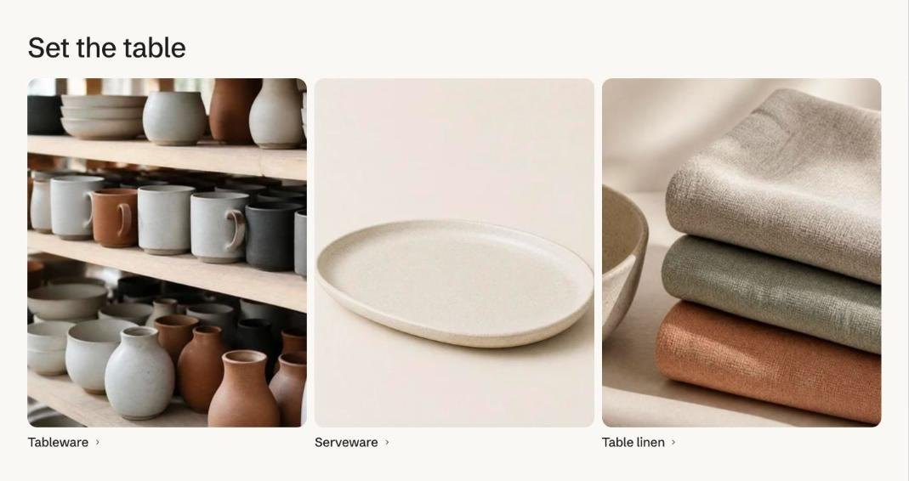

import { Aside, Steps } from '@astrojs/starlight/components';

Collection tiles show large images with the title over them. A tile can link to any page instead of its collection, such as a filtered collection for "Shop by concern". Six tiles sit in three columns and two rows.

## Add the section

<Steps>

1. Open **Online Store > Themes > Customize** and go to the home page (or any template).
2. Click **Add section** and choose **Collection tiles**.
3. Fill in the content, then click **Save**.

</Steps>

## Section settings

| Setting | Type | What it does |
| --- | --- | --- |
| Heading | Text | Leave empty to hide it. |
| Height | Choice | Compact / Medium / Large. |
| Title | Choice | On the image / Under the image. |
| Columns on desktop | Choice | Automatic / 2 / 3 / 4. |
| Color scheme | Color scheme | One of the schemes from Theme settings > Colors. |

## Blocks

You can add up to 6 blocks.

### Tile

| Setting | Type | What it does |
| --- | --- | --- |
| Collection | Collection |  |
| Image | Image | Defaults to the collection image. |
| Title | Text | Defaults to the collection title. |
| Link | Link | Optional. Send the tile somewhere other than its collection, such as a filtered collection for a skin concern. |
