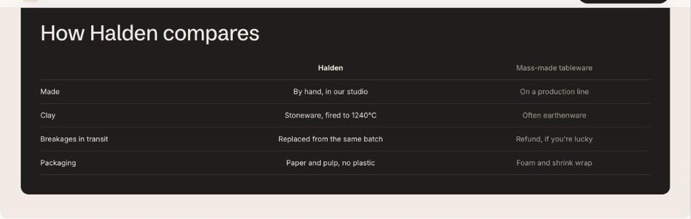

import { Aside, Steps } from '@astrojs/starlight/components';

The comparison table sets your product against one or two alternatives. Each **Row** block is one attribute. On a product page the first column uses the product's title by default.

## Add the section

<Steps>

1. Open **Online Store > Themes > Customize** and go to any page.
2. Click **Add section** and choose **Comparison table**.
3. Fill in the content, then click **Save**.

</Steps>

## Section settings

| Setting | Type | What it does |
| --- | --- | --- |
| Heading | Text | Leave empty to hide it. |
| Your column | Text | Leave blank on product pages to use the product title. |
| Second column | Text |  |
| Third column | Text |  |
| Card color scheme | Color scheme | The scheme used inside the cards, so they can stand out from the section background. |

## Blocks

You can add up to 12 blocks.

### Row

| Setting | Type | What it does |
| --- | --- | --- |
| Attribute | Text |  |
| Your value | Text |  |
| Second column value | Text |  |
| Third column value | Text |  |
