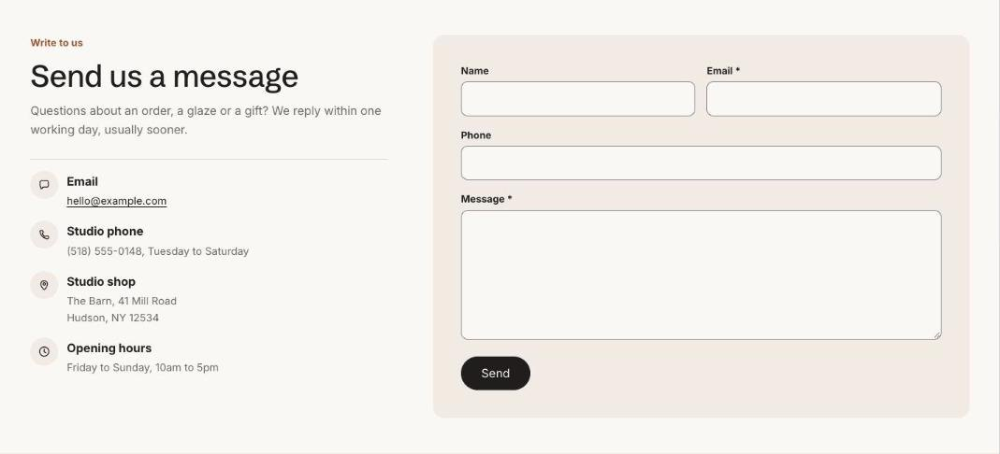

import { Aside, Steps } from '@astrojs/starlight/components';

Contact form sends messages to your store's sender email, set in **Settings > Notifications**. Add **Contact detail** blocks for your email, phone, hours or address beside the form. On a page it can show the page's own title and content, so it can be the whole contact page.

## Add the section

<Steps>

1. Open **Online Store > Themes > Customize** and go to a page using the page.contact template.
2. Click **Add section** and choose **Contact form**.
3. Fill in the content, then click **Save**.

</Steps>

## Section settings

| Setting | Type | What it does |
| --- | --- | --- |
| Show the page's title and content | On or off | On a page, the heading defaults to the page title and the page's text appears under it, so this section can be the whole contact page. |
| Small heading | Text | A short line above the heading, such as a category or a promise. |
| Heading | Text | Leave empty to hide it. |
| Heading level | Choice | Auto / H1, main heading / H2, section heading. Auto makes this the page's main heading (H1) when the section is first on the page. Use H2 when the page has its own title further down. |
| Text | Rich text | Supporting copy under the heading. |
| Show to | Choice | Everyone / Everyone except wholesale customers / Wholesale customers only. Wholesale customers are shoppers signed in to a B2B company. The section always shows in the theme editor. |
| Color scheme | Color scheme | One of the schemes from Theme settings > Colors. |

## Blocks

You can add up to 6 blocks.

### Contact detail

| Setting | Type | What it does |
| --- | --- | --- |
| Icon | Choice | Message / Phone / Location / Hours / Delivery / Person. |
| Title | Text |  |
| Text | Rich text | Supporting copy under the heading. |
