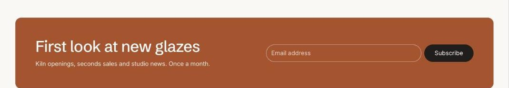

import { Aside, Steps } from '@astrojs/starlight/components';

Email sign-up saves subscribers as customers with marketing consent and the newsletter tag. Find them in **Customers** and use them in Shopify Email or your marketing app.

## Add the section

<Steps>

1. Open **Online Store > Themes > Customize** and go to the home page (or any template).
2. Click **Add section** and choose **Email sign-up**.
3. Fill in the content, then click **Save**.

</Steps>

## Section settings

| Setting | Type | What it does |
| --- | --- | --- |
| Heading | Text | Leave empty to hide it. |
| Text | Rich text | Supporting copy under the heading. |
| Card color scheme | Color scheme | The scheme used inside the cards, so they can stand out from the section background. |
