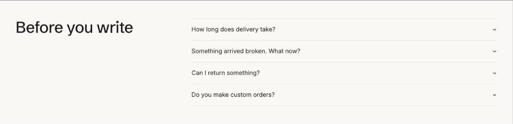

import { Aside, Steps } from '@astrojs/starlight/components';

FAQ shows questions in collapsible rows. Add **Topic** blocks to group questions; with two or more topics they become tabs. Turn on **Add FAQ structured data** so search engines can show your answers in results.

## Add the section

<Steps>

1. Open **Online Store > Themes > Customize** and go to any page.
2. Click **Add section** and choose **FAQ**.
3. Fill in the content, then click **Save**.

</Steps>

## Section settings

| Setting | Type | What it does |
| --- | --- | --- |
| Heading | Text | Leave empty to hide it. |
| Text | Rich text | Supporting copy under the heading. |
| Add FAQ structured data | On or off | Helps search engines understand the questions and answers. |
| Show to | Choice | Everyone / Everyone except wholesale customers / Wholesale customers only. Wholesale customers are shoppers signed in to a B2B company. The section always shows in the theme editor. |
| Color scheme | Color scheme | One of the schemes from Theme settings > Colors. |

## Blocks

You can add up to 40 blocks.

### Topic

| Setting | Type | What it does |
| --- | --- | --- |
| Topic | Text |  |

### Question

| Setting | Type | What it does |
| --- | --- | --- |
| Question | Text |  |
| Answer | Rich text |  |
