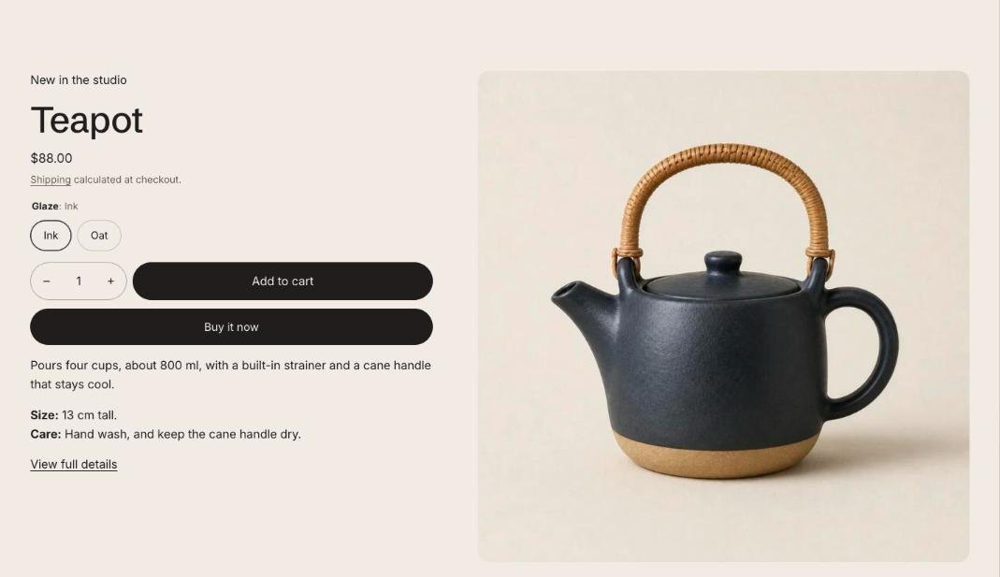

import { Aside, Steps } from '@astrojs/starlight/components';

Featured product shows one product anywhere in your store, with its images, video and 3D models, variant picker and buy buttons. It uses the same building blocks as the product page, and picking a variant here doesn't change the page address.

## Add the section

<Steps>

1. Open **Online Store > Themes > Customize** and go to the home page (or any template).
2. Click **Add section** and choose **Featured product**.
3. Fill in the content, then click **Save**.

</Steps>

## Section settings

| Setting | Type | What it does |
| --- | --- | --- |
| Product | Product |  |
| Color scheme | Color scheme | One of the schemes from Theme settings > Colors. |
| Show "View full details" link | On or off |  |
| **Media** | | |
| Media position on larger screens | Choice | Left / Right. |
| Show thumbnails | On or off | Shows one image at a time with thumbnails under it. Turn off to show all media in a grid on larger screens and swipe through it on phones. |

## Blocks

You can add up to 16 blocks.

### App

Adds a block from an installed app, such as reviews or subscriptions. Only apps that offer app blocks show up here.

### Vendor

This block has no settings. Drag it to change where it shows.

### Title

This block has no settings. Drag it to change where it shows.

### Rating

| Setting | Type | What it does |
| --- | --- | --- |
| Reviews section ID | Text | Optional. The ID of your reviews app's section, so the rating links to the reviews. |

### Price

This block has no settings. Drag it to change where it shows.

### Stock

| Setting | Type | What it does |
| --- | --- | --- |
| Show "Only X left" at or below | Slider | 1 to 30. |
| Show stock bar | On or off |  |
| Show "In stock" above the threshold | On or off |  |
| Pre-order message | Text | For variants set to keep selling when out of stock. Leave blank to hide. |

### Variant picker

| Setting | Type | What it does |
| --- | --- | --- |
| Style | Choice | Buttons / Dropdown. Options with swatches always show as swatches. |

### Buy buttons

| Setting | Type | What it does |
| --- | --- | --- |
| Show quantity selector | On or off |  |
| Show dynamic checkout buttons | On or off | Shows the payment methods your store offers, such as Shop Pay or PayPal. |
| Show recipient form for gift cards | On or off | Lets customers send a gift card directly to someone, with a personal message. |

### Description

This block has no settings. Drag it to change where it shows.

### Text

| Setting | Type | What it does |
| --- | --- | --- |
| Text | Rich text | Supporting copy under the heading. |

### Custom Liquid

| Setting | Type | What it does |
| --- | --- | --- |
| Liquid code | Liquid | Add app snippets or other code to create advanced customizations. |

## Tips

- Add app blocks for reviews or subscriptions, just like on the product page.
- Turn on **Show "View full details" link** so shoppers can reach the full product page.
