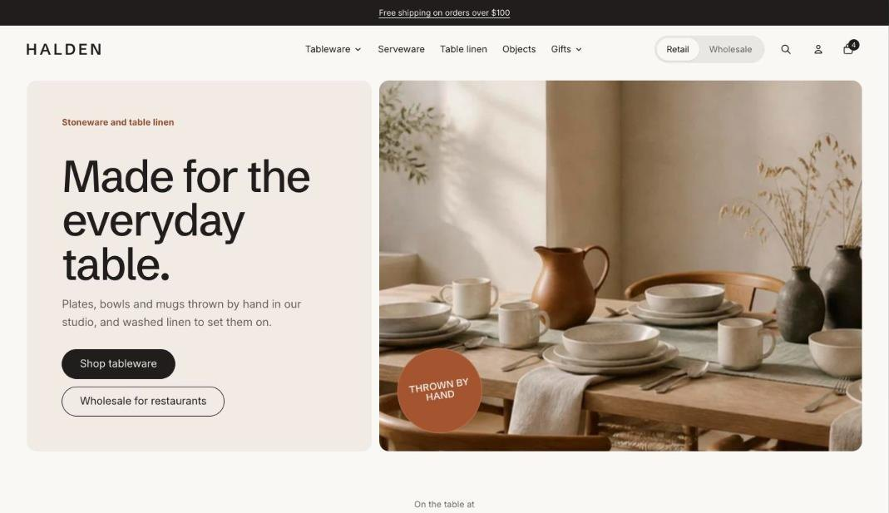

import { Aside, Steps } from '@astrojs/starlight/components';

The hero is the first thing shoppers see: a large heading and up to two buttons beside, over or above an image or video. The stage layout centers the text over a wide product shot, which suits cut-out product photos.

## Add the section

<Steps>

1. Open **Online Store > Themes > Customize** and go to the home page (or any template).
2. Click **Add section** and choose **Hero**.
3. Fill in the content, then click **Save**.

</Steps>

## A different button for wholesale customers

Turn on **Different second button for wholesale customers** to swap the second button for signed-in wholesale buyers, for example "Your wholesale account" instead of "Become a stockist". Leave its label empty to hide the button for them.

## Section settings

| Setting | Type | What it does |
| --- | --- | --- |
| Layout | Choice | Text beside image / Text over image / Text above image / Text only. Text above image works best with a wide, cut-out product shot on a transparent or plain background. |
| Height | Choice | Medium / Large. |
| Image | Image | Upload an image or pick one from your files. |
| Phone image | Image | Optional. A taller crop for small screens. |
| Image fit | Choice | Fill / Fit. Fill crops the image to the frame. Fit shows the whole image, which suits product cut-outs and wide line-ups. |
| Video | Video | Plays muted on a loop instead of the image. Keep it short and small. |
| Small heading | Text | A short line above the heading, such as a category or a promise. |
| Heading | Text | Leave empty to hide it. |
| Heading level | Choice | Auto / H1, main heading / H2, section heading. Auto makes this the page's main heading (H1) when the section is first on the page. Use H2 when the page has its own title further down. |
| Heading size | Choice | Large / Huge. |
| Text | Rich text | Supporting copy under the heading. |
| Button label | Text | Leave empty to hide the button. |
| Button link | Link | A page, product, collection or web address. |
| Second button label | Text | Leave empty to hide the second button. |
| Second button link | Link | A page, product, collection or web address. |
| Different second button for wholesale customers | On or off | Signed-in wholesale customers see this button instead, for example "Your wholesale account" in place of "Become a retailer". Leave the label empty to hide it for them. |
| Wholesale button label | Text |  |
| Wholesale button link | Link |  |
| Text panel color scheme | Color scheme |  |

## Blocks

### Sticker

| Setting | Type | What it does |
| --- | --- | --- |
| Text | Text | A few words, such as Freshly roasted or New flavor. |
| Shape | Choice | Circle / Starburst / Tag. |
| Position | Choice | Top left / Top right / Middle left / Middle right / Bottom left / Bottom right. |
| Tilt | Slider | -20 to 20 °. |
| Motion | Choice | None / Sway / Spin (starburst). |
| Color scheme | Color scheme | One of the schemes from Theme settings > Colors. |

## Tips

- Use a phone image cropped for portrait screens so the subject stays in view.
- The first hero image loads straight away, so keep it under about 500 KB.
