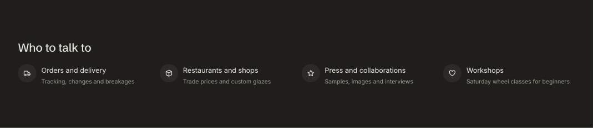

import { Aside, Steps } from '@astrojs/starlight/components';

Icon row shows short promises with icons, such as free shipping, easy returns or certifications.

## Add the section

<Steps>

1. Open **Online Store > Themes > Customize** and go to any page.
2. Click **Add section** and choose **Icon row**.
3. Fill in the content, then click **Save**.

</Steps>

## Section settings

| Setting | Type | What it does |
| --- | --- | --- |
| Heading | Text | Leave empty to hide it. |
| Show to | Choice | Everyone / Everyone except wholesale customers / Wholesale customers only. Wholesale customers are shoppers signed in to a B2B company. The section always shows in the theme editor. |
| Color scheme | Color scheme | One of the schemes from Theme settings > Colors. |

## Blocks

You can add up to 6 blocks.

### Item

| Setting | Type | What it does |
| --- | --- | --- |
| Icon | Choice | None / Delivery / Returns / Leaf / Shield / Check / Heart / Gift / Box / Chat / Refill / Star. |
| Title | Text |  |
| Text | Text | Supporting copy under the heading. |
