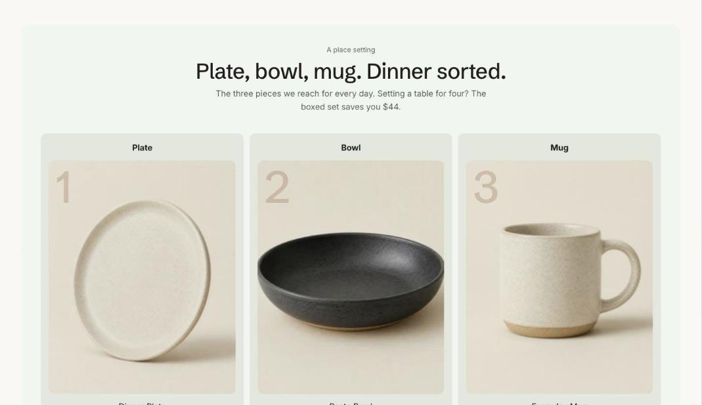

import { Aside, Steps } from '@astrojs/starlight/components';

Product bundle lists products bought together and adds them to the cart in one click. The Routine layout numbers them as steps, such as 01 Cleanse and 02 Treat. It can compare the total with a boxed set and shows the saving only when the set really costs less. On a product page the current product can lead the list.

## Add the section

<Steps>

1. Open **Online Store > Themes > Customize** and go to the home page or the product template.
2. Click **Add section** and choose **Product bundle**.
3. Fill in the content, then click **Save**.

</Steps>

## Section settings

| Setting | Type | What it does |
| --- | --- | --- |
| Small heading | Text | A short line above the heading, such as a category or a promise. |
| Heading | Text | Leave empty to hide it. |
| Text | Rich text | Supporting copy under the heading. |
| Layout | Choice | List / Routine steps. |
| Step label | Choice | Step number over the name / Large number on the image. Used by the Routine layout. |
| Products | Products |  |
| Step names | Text | Separated by commas, in product order. Shown with the Routine steps layout. |
| Boxed set | Product | Optional. A set of the same products. When it costs less than buying them separately, the saving is shown. |
| Start with the current product | On or off | On product pages, the product being viewed leads the list. |
| Note under the button | Text | For example, a bundle discount applied at checkout. Set up the discount itself in Discounts. |
| Card color scheme | Color scheme | The scheme used inside the cards, so they can stand out from the section background. |
