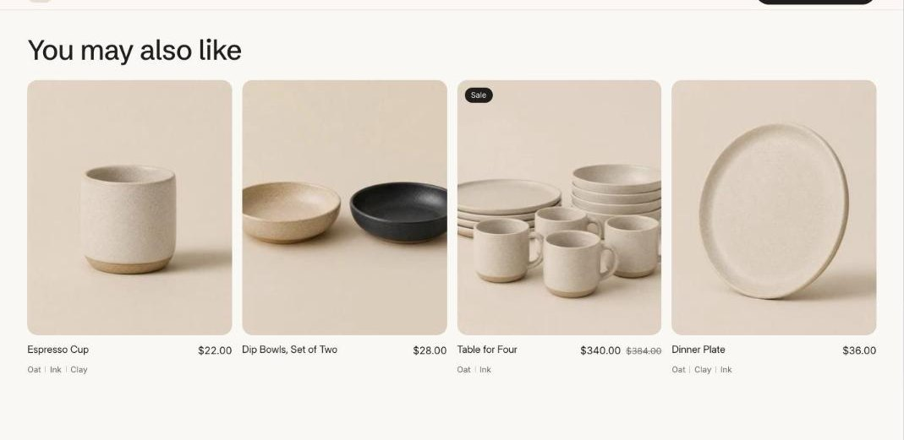

import { Aside, Steps } from '@astrojs/starlight/components';

Product recommendations shows related products chosen by Shopify, or complementary products you pick in the Search and Discovery app.

## Add the section

<Steps>

1. Open **Online Store > Themes > Customize** and go to the product template.
2. Click **Add section** and choose **Product recommendations**.
3. Fill in the content, then click **Save**.

</Steps>

## Section settings

| Setting | Type | What it does |
| --- | --- | --- |
| Heading | Text | Leave empty to hide it. |
| Recommendation type | Choice | Related products / Complementary products. |
| Products to show | Slider | 2 to 10. |
| Products per row on desktop | Slider | 2 to 5. |
| Show second image on hover | On or off | Shows the product's second image when a shopper hovers over the card. |
| Color scheme | Color scheme | One of the schemes from Theme settings > Colors. |
