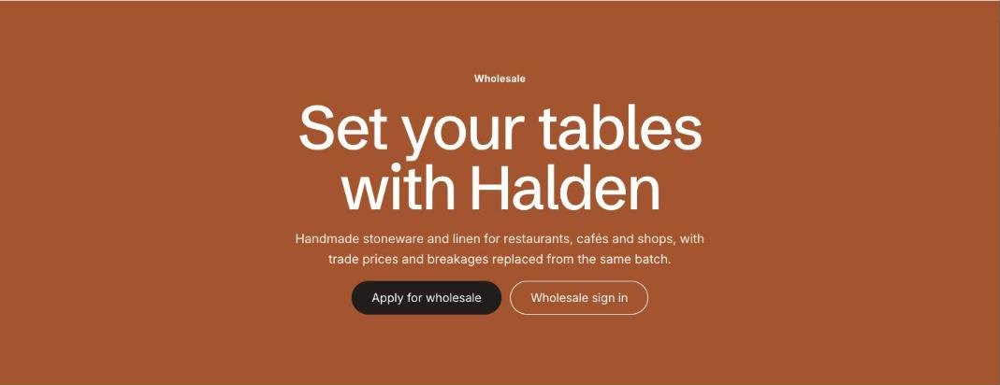

import { Aside, Steps } from '@astrojs/starlight/components';

Rich text is a short statement: small heading, heading, text and up to two buttons, centered or left-aligned.

## Add the section

<Steps>

1. Open **Online Store > Themes > Customize** and go to the home page (or any template).
2. Click **Add section** and choose **Rich text**.
3. Fill in the content, then click **Save**.

</Steps>

## Section settings

| Setting | Type | What it does |
| --- | --- | --- |
| Alignment | Choice | Left / Center. |
| Small heading | Text | A short line above the heading, such as a category or a promise. |
| Heading | Text | Leave empty to hide it. |
| Heading level | Choice | Auto / H1, main heading / H2, section heading. Auto makes this the page's main heading (H1) when the section is first on the page. Use H2 when the page has its own title further down. |
| Large heading | On or off |  |
| Text | Rich text | Supporting copy under the heading. |
| Button label | Text | Leave empty to hide the button. |
| Button link | Link | A page, product, collection or web address. |
| Second button label | Text | Leave empty to hide the second button. |
| Second button link | Link | A page, product, collection or web address. |
| Show to | Choice | Everyone / Everyone except wholesale customers / Wholesale customers only. Wholesale customers are shoppers signed in to a B2B company. The section always shows in the theme editor. |
| Color scheme | Color scheme | One of the schemes from Theme settings > Colors. |
