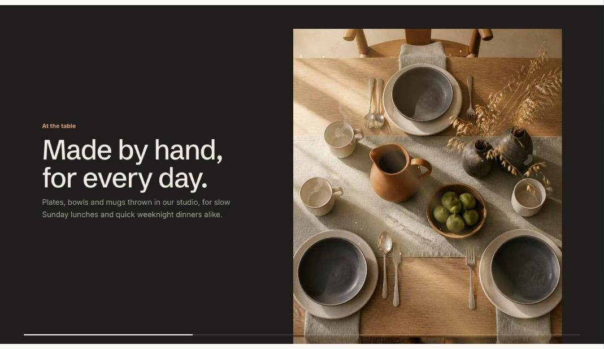

import { Aside, Steps } from '@astrojs/starlight/components';

Scroll story pins a stage on screen and moves through two to four beats as the shopper scrolls. Each **Beat** block has its own heading and text. The visual can be:

- **Product shots**: a cut-out product image per beat that crossfades and scales, with ingredient chips around it.
- **Images**: one full image per beat behind the text.
- **Illustration**: the built-in bottle drawing, which turns, fills and shows its ingredients.
- **Lottie**: an animation that plays as the shopper scrolls, from a Lottie JSON file.

Shoppers who prefer reduced motion, or whose browser has scripts turned off, see the beats stacked one after another.

## Add the section

<Steps>

1. Open **Online Store > Themes > Customize** and go to the home page (or any template).
2. Click **Add section** and choose **Scroll story**.
3. Fill in the content, then click **Save**.

</Steps>

## Use a Lottie animation

Upload your Lottie `.json` file in **Content > Files**, copy its link and paste it into **Lottie file link**. Choose **Playback** to tie the animation to scrolling or let it loop, and add a still image for shoppers who prefer reduced motion. See [Scroll story with Lottie](/tandem/guides/lottie/).

## Expand while pinned

**Expand to full width while pinned** grows the panel from the page width to the edges of the screen as it pins. Give the stage a different color scheme from the section, or the growth won't show.

## Section settings

| Setting | Type | What it does |
| --- | --- | --- |
| Visual | Choice | Product shot per beat / Lottie animation / Bottle illustration / One image per beat. |
| Expand to full width while pinned | On or off | The panel grows to the edges of the screen as it pins, and shrinks back as it leaves. Give the stage a different color scheme from the section so the growth shows. |
| Scroll length per beat | Slider | 40 to 200%. How far shoppers scroll for each beat, as a share of the screen height. |
| **Lottie animation** | | |
| Lottie file link | Text | Upload a Lottie .json file in Content > Files, copy its link and paste it here. Keep it under 500 KB and without expressions. |
| Playback | Choice | Follow scrolling / Loop while on screen. |
| Still image | Image | Shown while the animation loads and when it can't play. |
| Animation description | Text | Read by screen readers. Leave empty if the animation is decorative. |
| **Ingredients** | | |
| Ingredient 1 | Text |  |
| Ingredient image | Image |  |
| Ingredient 2 | Text |  |
| Ingredient image | Image |  |
| Ingredient 3 | Text |  |
| Ingredient image | Image |  |
| **Bottle illustration** | | |
| Label brand | Text | Defaults to the store name. |
| Label product name | Text |  |
| Label size | Text |  |
| Liquid color | Color |  |
| Illustration description | Text | Read by screen readers. Defaults to the product name. |
| **Colors** | | |
| Color scheme | Color scheme | One of the schemes from Theme settings > Colors. |
| Stage color scheme | Color scheme |  |

## Blocks

You can add up to 4 blocks.

### Beat

| Setting | Type | What it does |
| --- | --- | --- |
| Image | Image | Product shot: use a cut-out with a transparent background, about 1400px tall. Beats without an image keep the previous shot. One image per beat: fills the stage behind the text. |
| Small heading | Text | A short line above the heading, such as a category or a promise. |
| Heading | Text | Leave empty to hide it. |
| Text | Rich text | Supporting copy under the heading. |
| Button label | Text | Leave empty to hide the button. |
| Button link | Link | A page, product, collection or web address. |
