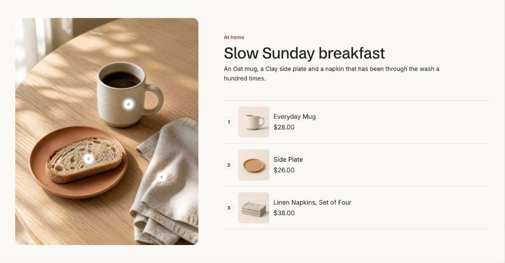

import { Aside, Steps } from '@astrojs/starlight/components';

Shoppable image places hotspots on a lifestyle image. Each hotspot opens a small card with the product's image, price and an add button. On larger screens the card opens beside its dot; on phones it sits across the bottom of the image.

## Add the section

<Steps>

1. Open **Online Store > Themes > Customize** and go to the home page (or any template).
2. Click **Add section** and choose **Shoppable image**.
3. Fill in the content, then click **Save**.

</Steps>

## Place the hotspots

Each **Hotspot** block has horizontal and vertical position sliders, in percent of the image width and height. Select the block in the editor and move the sliders until the dot sits on the product. If you use a phone image, keep the same framing so the positions still match.

## Section settings

| Setting | Type | What it does |
| --- | --- | --- |
| Image | Image | Upload an image or pick one from your files. |
| Phone image | Image | Optional. Hotspots keep the same positions, so keep the products in the same place in the frame. |
| Small heading | Text | A short line above the heading, such as a category or a promise. |
| Heading | Text | Leave empty to hide it. |
| Text | Rich text | Supporting copy under the heading. |
| Layout | Choice | Image / Image with product list. |
| Hotspot style | Choice | Dot / Plus / Number. |
| Show add to cart | On or off | Products with options open a quick picker. |
| Full width | On or off |  |
| Color scheme | Color scheme | One of the schemes from Theme settings > Colors. |

## Blocks

You can add up to 8 blocks.

### Hotspot

| Setting | Type | What it does |
| --- | --- | --- |
| Product | Product |  |
| Position from left | Slider | 0 to 100%. |
| Position from top | Slider | 0 to 100%. |
| Label | Text | Used when no product is chosen. |
