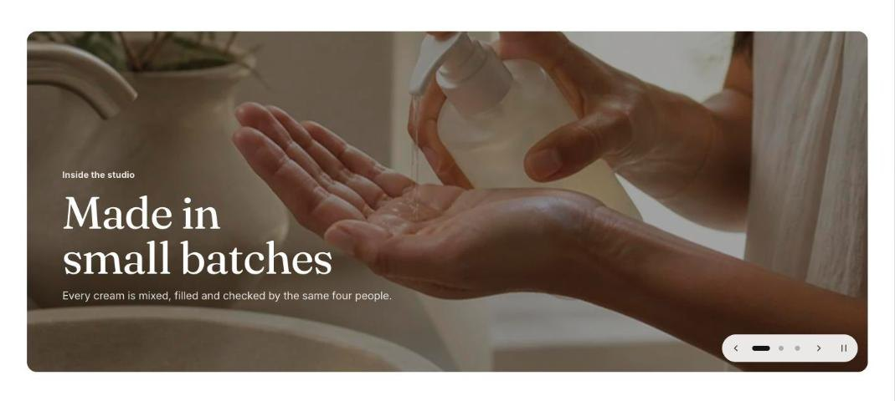

import { Aside, Steps } from '@astrojs/starlight/components';

The slideshow shows slides that move sideways or fade, each with an image, an optional phone image, text and up to two buttons. Arrows, slide markers and the keyboard move between slides. Autoplay pauses on hover, focus and touch, and stays off for shoppers who prefer reduced motion.

## Add the section

<Steps>

1. Open **Online Store > Themes > Customize** and go to the home page (or any template).
2. Click **Add section** and choose **Slideshow**.
3. Fill in the content, then click **Save**.

</Steps>

## Section settings

| Setting | Type | What it does |
| --- | --- | --- |
| Slideshow name | Text | Read out to screen reader users, for example Featured collections. Not shown on the page. |
| Height | Choice | Fit the first image / Small / Medium / Large / Full screen. |
| Full width | On or off |  |
| Transition | Choice | Slide / Fade. |
| Slide markers | Choice | Dots / Counter (1 / 3). |
| Change slides automatically | On or off | Pauses on hover, focus and touch, and has a pause button. Shoppers who prefer reduced motion change slides themselves. |
| Time per slide | Slider | 3 to 10 s. |
| Heading level | Choice | Auto / H1, main heading / H2, section heading. Applies to the first slide. Auto makes it the page's main heading (H1) when the slideshow is first on the page. |
| Color scheme | Color scheme | Used by the text box and the section's padding. |

## Blocks

You can add up to 6 blocks.

### Slide

| Setting | Type | What it does |
| --- | --- | --- |
| Image | Image | Upload an image or pick one from your files. |
| Phone image | Image | Optional. A taller crop usually works better on phones. |
| Small heading | Text | A short line above the heading, such as a category or a promise. |
| Heading | Text | Leave empty to hide it. |
| Heading size | Choice | Medium / Large. |
| Text | Rich text | Supporting copy under the heading. |
| Button label | Text | Leave empty to hide the button. |
| Button link | Link | A page, product, collection or web address. |
| Second button label | Text | Leave empty to hide the second button. |
| Second button link | Link | A page, product, collection or web address. |
| **Text** | | |
| Horizontal position | Choice | Left / Center / Right. |
| Vertical position | Choice | Top / Middle / Bottom. |
| Text color | Choice | Light / Dark. |
| Image overlay | Slider | 0 to 80%. Darkens the image behind light text, or lightens it behind dark text, so the words stay readable. |
| Show text in a box | On or off | Puts the text on a panel in the section's color scheme. |
