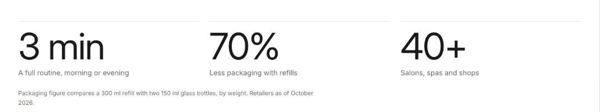

import { Aside, Steps } from '@astrojs/starlight/components';

Stats shows big numbers with short labels. Numbers can count up as they scroll into view, and always show in full for shoppers who prefer reduced motion.

## Add the section

<Steps>

1. Open **Online Store > Themes > Customize** and go to any page.
2. Click **Add section** and choose **Stats**.
3. Fill in the content, then click **Save**.

</Steps>

## Section settings

| Setting | Type | What it does |
| --- | --- | --- |
| Heading | Text | Leave empty to hide it. |
| Count up when shown | On or off |  |
| Footnote | Text | Say where the numbers come from, such as a study or the date they were measured. |
| Color scheme | Color scheme | One of the schemes from Theme settings > Colors. |

## Blocks

You can add up to 4 blocks.

### Stat

| Setting | Type | What it does |
| --- | --- | --- |
| Number | Number |  |
| Before the number | Text |  |
| After the number | Text |  |
| Label | Text |  |
