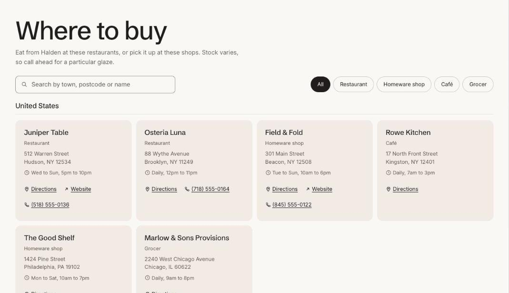

import { Aside, Steps } from '@astrojs/starlight/components';

Store locator lists every shop that carries your brand, grouped by country, with a search box and a filter by type of shop. Each **Store** block is one stockist. Online-only retailers get their own group at the end, and Directions opens the address in the shopper's maps app.

## Add the section

<Steps>

1. Open **Online Store > Themes > Customize** and go to a page using the page.stockists template.
2. Click **Add section** and choose **Store locator**.
3. Fill in the content, then click **Save**.

</Steps>

## Section settings

| Setting | Type | What it does |
| --- | --- | --- |
| Heading | Text | Leave empty to hide it. |
| Heading level | Choice | Auto / H1, main heading / H2, section heading. Auto makes this the page's main heading (H1) when the section is first on the page. Use H2 when the page has its own title further down. |
| Large heading | On or off | Use when this is the main heading on the page. |
| Text | Rich text | Supporting copy under the heading. |
| Show search | On or off |  |
| Show filter by type | On or off | Appears when stores have at least two different types. |
| Show directions link | On or off |  |
| Heading for online retailers | Text |  |
| Color scheme | Color scheme | One of the schemes from Theme settings > Colors. |
| Card color scheme | Color scheme | The scheme used inside the cards, so they can stand out from the section background. |

## Blocks

You can add up to 50 blocks.

### Store

| Setting | Type | What it does |
| --- | --- | --- |
| Name | Text |  |
| Type | Text | For example Spa, Salon or Pharmacy. Used for the filter. |
| Online only | On or off |  |
| Street address | Text |  |
| City, state and ZIP code | Text | For example Portland, OR 97205. |
| Country | Text | Stores are grouped by this. |
| Opening hours | Text | For example Tue to Sat, 10am to 6pm. |
| Phone | Text |  |
| Website | Link |  |
