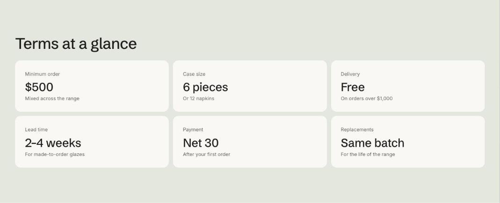

import { Aside, Steps } from '@astrojs/starlight/components';

Terms at a glance shows short facts as tiles, each with a value, a label and an optional note. Use it on a trade page for the opening order, case sizes, lead time and payment terms, with a link to the full terms underneath.

## Add the section

<Steps>

1. Open **Online Store > Themes > Customize** and go to any page.
2. Click **Add section** and choose **Terms at a glance**.
3. Fill in the content, then click **Save**.

</Steps>

## Section settings

| Setting | Type | What it does |
| --- | --- | --- |
| Small heading | Text | A short line above the heading, such as a category or a promise. |
| Heading | Text | Leave empty to hide it. |
| Text | Rich text | Supporting copy under the heading. |
| Button label | Text | Leave empty to hide the button. |
| Button link | Link | A page, product, collection or web address. |
| Show to | Choice | Everyone / Everyone except wholesale customers / Wholesale customers only. Wholesale customers are shoppers signed in to a B2B company. The section always shows in the theme editor. |
| Color scheme | Color scheme | One of the schemes from Theme settings > Colors. |
| Card color scheme | Color scheme | The scheme used inside the cards, so they can stand out from the section background. |

## Blocks

You can add up to 8 blocks.

### Term

| Setting | Type | What it does |
| --- | --- | --- |
| Label | Text |  |
| Value | Text |  |
| Note | Text |  |
