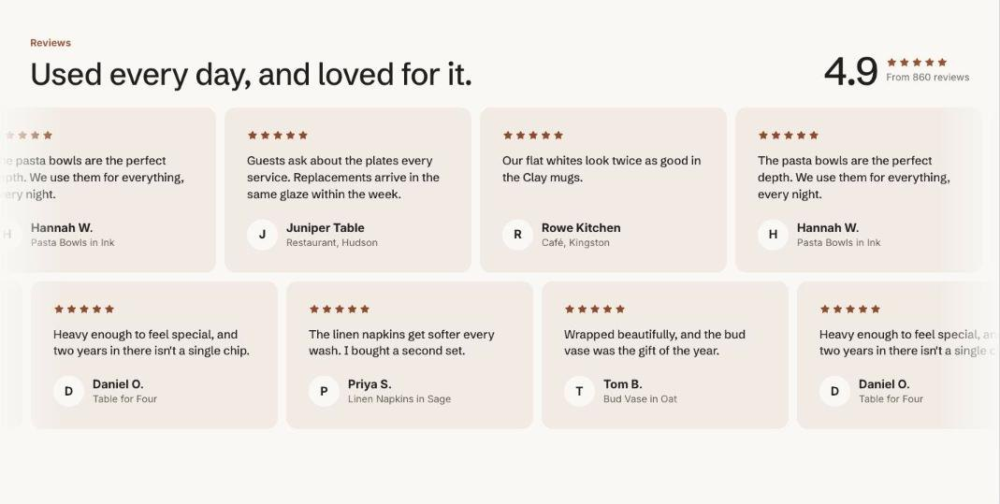

import { Aside, Steps } from '@astrojs/starlight/components';

Testimonials shows customer quotes with an optional star rating, photo and product link, plus an optional rating summary above them. Choose one of three layouts:

- **Carousel**: large cards with previous and next buttons.
- **Moving rows**: rows that drift in opposite directions, with a pause button. Six or more quotes are split into two rows.
- **Grid**: every quote at once.

## Add the section

<Steps>

1. Open **Online Store > Themes > Customize** and go to the home page (or any template).
2. Click **Add section** and choose **Testimonials**.
3. Fill in the content, then click **Save**.

</Steps>

## Section settings

| Setting | Type | What it does |
| --- | --- | --- |
| Small heading | Text | A short line above the heading, such as a category or a promise. |
| Heading | Text | Leave empty to hide it. |
| Text | Rich text | Supporting copy under the heading. |
| Layout | Choice | Carousel / Moving rows / Grid. |
| Moving rows speed | Slider | 4 to 16 s. Seconds per quote for one full loop. Higher is slower. |
| **Rating summary** | | |
| Show rating summary | On or off |  |
| Average rating | Text |  |
| Summary text | Text |  |
| **Colors** | | |
| Show to | Choice | Everyone / Everyone except wholesale customers / Wholesale customers only. Wholesale customers are shoppers signed in to a B2B company. The section always shows in the theme editor. |
| Color scheme | Color scheme | One of the schemes from Theme settings > Colors. |
| Card color scheme | Color scheme | The scheme used inside the cards, so they can stand out from the section background. |

## Blocks

You can add up to 50 blocks.

### Quote

| Setting | Type | What it does |
| --- | --- | --- |
| Star rating | Slider | 0 to 5. |
| Quote | Rich text |  |
| Name | Text |  |
| Detail | Text |  |
| Photo | Image | A square photo of the customer or their shelf. Shows their initial when empty. |
| Product | Product |  |

## Tips

- Moving rows stop for shoppers who prefer reduced motion and can be scrolled by hand instead.
