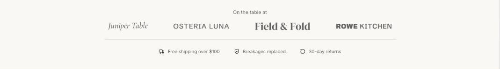

import { Aside, Steps } from '@astrojs/starlight/components';

Trust strip is a slim band of press or stockist logos and short promises, such as free shipping or cruelty-free. The stacked layout puts the logos on one row with the promises below; the inline layout puts both on one row.

## Add the section

<Steps>

1. Open **Online Store > Themes > Customize** and go to the home page (or any template).
2. Click **Add section** and choose **Trust strip**.
3. Fill in the content, then click **Save**.

</Steps>

## Section settings

| Setting | Type | What it does |
| --- | --- | --- |
| Layout | Choice | Stacked / One row. |
| Logos label | Text |  |
| Show logos in grayscale | On or off |  |
| Color scheme | Color scheme | One of the schemes from Theme settings > Colors. |

## Blocks

You can add up to 12 blocks.

### Logo

| Setting | Type | What it does |
| --- | --- | --- |
| Image | Image | A press, retailer or certification logo. Shown in grey when Monochrome is on. |
| Name | Text | Shown when there's no image, and read out by screen readers. |
| Button link | Link | A page, product, collection or web address. |

### Promise

| Setting | Type | What it does |
| --- | --- | --- |
| Icon | Choice | Delivery / Returns / Leaf / Heart / Shield / Award / Check. |
| Text | Text | Supporting copy under the heading. |

## Tips

- Logos look best as single-line wordmarks with no extra space around them.
