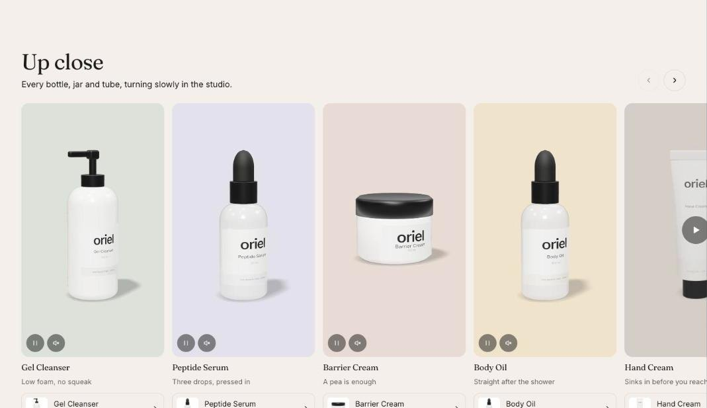

import { Aside, Steps } from '@astrojs/starlight/components';

Video carousel shows a row of short videos, each with a title and an optional product link. It scrolls with buttons on larger screens and swipes on phones.

## Add the section

<Steps>

1. Open **Online Store > Themes > Customize** and go to any page.
2. Click **Add section** and choose **Video carousel**.
3. Fill in the content, then click **Save**.

</Steps>

## Section settings

| Setting | Type | What it does |
| --- | --- | --- |
| Heading | Text | Leave empty to hide it. |
| Text | Rich text | Supporting copy under the heading. |
| Video shape | Choice | Portrait / Square / Landscape. |
| Play muted previews | On or off | Shopify-hosted videos loop silently while on screen. Off for shoppers who prefer reduced motion. |
| Color scheme | Color scheme | One of the schemes from Theme settings > Colors. |

## Blocks

You can add up to 12 blocks.

### Video

| Setting | Type | What it does |
| --- | --- | --- |
| Video | Video |  |
| Or a YouTube or Vimeo link | Video link | The player loads only after the play button is pressed. |
| Cover image | Image |  |
| Heading | Text | Leave empty to hide it. |
| Caption | Text |  |
| Product | Product |  |
