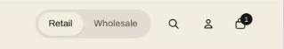

import { Steps } from '@astrojs/starlight/components';

The switch in the header lets wholesale buyers get to their side of the store in one click.

<Steps>

1. In the theme editor, select the **Header**.
2. Turn on **Show Retail / Wholesale switch**.
3. Set **Wholesale page** to where shoppers without a wholesale account go, such as your trade page. Leave it blank to use the sign-in page.
4. Set **Wholesale customer page** to where signed-in wholesale customers go, such as your quick order page. Leave it blank to use all collections.

</Steps>
