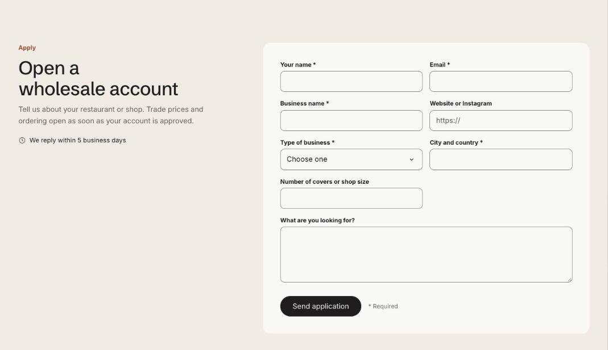

import { Aside, Steps } from '@astrojs/starlight/components';

The wholesale application is a form with the fields you need to judge a new stockist, such as business name, website, type of store and locations. Each field is a block, and the email field is always there. Submissions arrive in your inbox as contact form emails, labeled with the form name.

## Add the section

<Steps>

1. Open **Online Store > Themes > Customize** and go to a page using the page.trade template.
2. Click **Add section** and choose **Wholesale application**.
3. Fill in the content, then click **Save**.

</Steps>

## Use a form app instead

Add an **App** block, such as Shopify Forms, and the app's form replaces the built-in one. The heading and text stay.

## Section settings

| Setting | Type | What it does |
| --- | --- | --- |
| Small heading | Text | A short line above the heading, such as a category or a promise. |
| Heading | Text | Leave empty to hide it. |
| Text | Rich text | Supporting copy under the heading. |
| Response time | Text |  |
| Form name | Text | Shown at the top of each submission email, so you can tell applications from other messages. |
| Button label | Text | Leave empty to hide the button. |
| Confirmation heading | Text |  |
| Confirmation text | Rich text |  |
| Section ID | Text | Link to the form from a button with #apply. |
| Show to | Choice | Everyone / Everyone except wholesale customers / Wholesale customers only. Wholesale customers are shoppers signed in to a B2B company. The section always shows in the theme editor. |
| Color scheme | Color scheme | One of the schemes from Theme settings > Colors. |
| Card color scheme | Color scheme | The scheme used inside the cards, so they can stand out from the section background. |

## Blocks

You can add up to 14 blocks.

### App

Adds a block from an installed app, such as reviews or subscriptions. Only apps that offer app blocks show up here.

### Field

| Setting | Type | What it does |
| --- | --- | --- |
| Label | Text |  |
| Type | Choice | Text / Phone / Website / Number / Dropdown / Long text / Checkbox. |
| Dropdown options | Text | Separated by commas. |
| Placeholder | Text |  |
| Width | Choice | Half / Full. |
| Required | On or off |  |
